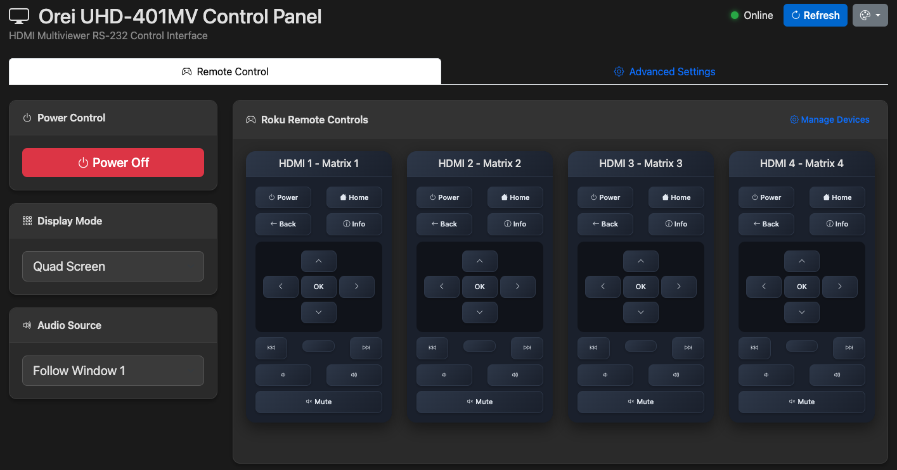
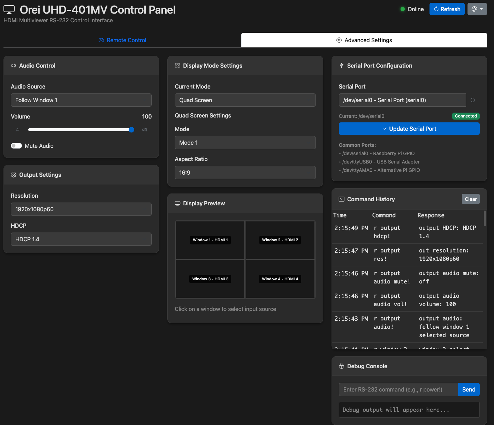
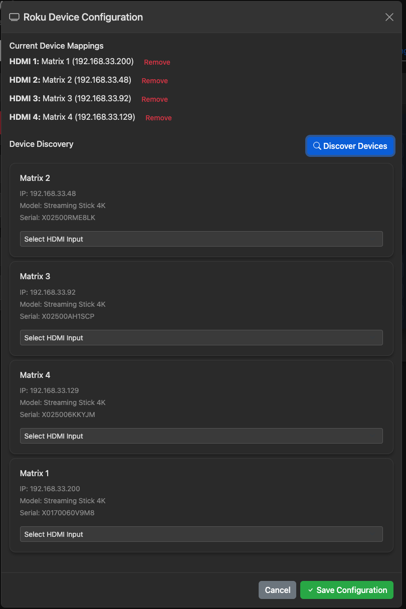

# Orei UHD-401MV Control Panel

A comprehensive web-based control interface for the Orei UHD-401MV HDMI Multiviewer with RS-232 communication and integrated Roku device control.

## Screenshots

### Main Interface - Remote Control Tab

*Remote control interface with integrated Roku device controls and responsive layout*

### Advanced Settings & Display Preview  

*Advanced settings with real-time display mode preview and window input assignment*

### Roku Device Configuration

*Modal-based Roku device discovery and mapping interface*

## Features

### Core Device Control
- **Power Control**: Turn the multiviewer device on/off
- **Display Modes**: Single, PIP, PBP, Triple, and Quad screen modes with real-time preview
- **Audio Control**: Volume slider with up/down buttons, mute toggle, and source selection
- **Window Input Assignment**: Interactive display diagram for setting HDMI inputs per window
- **Output Settings**: Resolution and HDCP configuration
- **Advanced Mode Settings**: Position, size, and aspect ratio controls for each display mode

### Roku Integration
- **Device Discovery**: Automatic network scanning for Roku devices using SSDP and network probing
- **Device Management**: Modal-based configuration interface for mapping Roku devices to display windows
- **Remote Controls**: Dynamic Roku remote interfaces that appear based on current display mode
- **Window-Aware Remotes**: Only shows remotes for visible display windows
- **Horizontal Layout**: Optimized side-by-side remote layout for multi-window modes

### User Interface
- **Theme Support**: Auto, Light, and Dark themes with full modal and component coverage
- **Responsive Design**: Optimized for desktop, tablet, and mobile devices
- **Tab Navigation**: Separate Remote Control and Advanced Settings tabs
- **Modal Dialogs**: Non-intrusive device configuration workflow
- **Real-time Updates**: Event-driven UI updates when settings change
- **Toast Notifications**: User feedback for all actions and status changes

### Technical Features
- **Serialized Commands**: One RS-232 command at a time under a lock, with a 200ms settle before reading the response
- **Command History**: Last 50 RS-232 commands and responses, kept in memory
- **Debug Console**: Send custom commands for testing and troubleshooting
- **Reconnect on Error**: A serial error marks the port disconnected, and the next command reopens it

## Quick Start

1. **Hardware Setup**: Connect RS-232 cable between Raspberry Pi and Orei UHD-401MV
2. **Install**: Run `./setup.sh` on fresh Raspberry Pi OS
3. **Configure**: Access web interface at `http://your-pi-ip`
4. **Roku Setup**: Use "Configure Roku Devices" to discover and map your Roku devices
5. **Control**: Use the interface to control both the multiviewer and connected Roku devices

## Installation

### Automated Setup (Recommended)
```bash
git clone <repository-url>
cd orei-control
chmod +x setup.sh
./setup.sh
```

### Manual Installation
```bash
# Install dependencies
sudo apt update && sudo apt install -y python3-pip python3-venv netcat-openbsd nmap

# Create virtual environment
python3 -m venv venv
source venv/bin/activate

# Install Python packages
pip install -r requirements.txt

# Start the server (port 5000, production config)
python app.py

# Or: dev port, debug/auto-reload, and a separate config file
OREI_CONFIG=app_config_dev.json python app.py --port 8080 --debug
```

`setup.sh` also enables the UART (`enable_uart=1` in the boot config, reboot required), adds the user to the `dialout` group, and installs the systemd service and nginx proxy. A manual install needs those steps for serial access and port 80.

## Usage Guide

### Initial Setup
1. Power on the Orei UHD-401MV device
2. Access the web interface
3. Click "Refresh" to load current device settings
4. Go to "Configure Roku Devices" to set up streaming device control

### Basic Operation
- **Power**: Toggle device power with the power button
- **Display Mode**: Select layout from dropdown (updates real-time preview)
- **Window Inputs**: Click windows in the diagram to assign HDMI sources
- **Audio**: Use volume slider/buttons and select audio source
- **Roku Control**: Use virtual remotes that appear for active display windows

### Advanced Features
- **Theme Selection**: Use theme dropdown in header to switch between light/dark modes
- **Debug Console**: Send custom RS-232 commands in Advanced Settings tab
- **Command History**: Monitor all device communication for troubleshooting
- **Modal Management**: Configure Roku devices without leaving current context

### Roku Device Setup
1. Click "Configure Roku Devices" or "Manage Devices" button
2. Click "Discover Devices" to scan your network
3. Select discovered devices and assign them to display windows
4. Click "Save Configuration" to apply mappings
5. Roku remotes will automatically appear for assigned windows

## Configuration

### RS-232 Settings
- **Port**: `/dev/serial0` (Raspberry Pi GPIO) or `/dev/ttyUSB0` (USB adapter)
- **Baud Rate**: 115200
- **Data Bits**: 8, Stop Bits: 1, Parity: None
- **Timeout**: 2 seconds
- **Command Delay**: 200ms between sequential commands

### Runtime Files
These live in the app's working directory and are gitignored, so updates never overwrite them.
- `app_config.json`: serial port and baud rate, saved from the Advanced Settings tab. Override the filename with the `OREI_CONFIG` environment variable.
- `roku_devices.json`: Roku device to HDMI input mappings. Roku IPs are stored here, so update it if devices move to a new subnet. The device names also label the window input and audio source dropdowns and the remote headers, as `Name (HDMI n)`.
- `branding.json`: optional page title and subtitle. Copy `branding.example.json` and edit it. Changes apply on the next page load, with no restart. Either key can be left out to keep the default.

### Network Requirements
- **Roku Discovery**: Devices must be on same subnet as Raspberry Pi
- **Ports**: TCP 8060 (Roku ECP), UDP 1900 (SSDP discovery)
- **Dependencies**: `netcat-openbsd` package for network scanning

### Device Compatibility
- **Multiviewer**: Orei UHD-401MV (tested with ASCII command protocol)
- **Roku Devices**: All modern Roku devices with External Control Protocol (ECP)
- **Network**: IPv4 networks with multicast support

## File Structure

```
├── app.py                          # Flask backend with API endpoints
├── static/
│   ├── index.html                  # Main responsive UI
│   ├── styles.css                  # Complete theme system and responsive design
│   └── js/
│       ├── main.js                 # Application initialization
│       ├── api.js                  # Rate-limited API client
│       ├── device.js               # Multiviewer device control
│       ├── display.js              # Display diagram and mode management
│       ├── audio.js                # Audio control functions
│       ├── roku.js                 # Roku device discovery and control
│       ├── commands.js             # Command history management
│       ├── system.js               # Shutdown, restart, and update controls
│       ├── theme.js                # Theme switching system
│       └── utils.js                # Shared utilities and toast notifications
├── rs-232_commands.md              # Orei RS-232 command reference
├── test-serial.py                  # Hardware check: serial port probe
├── test-roku.py                    # Hardware check: Roku discovery
├── setup.sh                        # Production install (/opt/orei-control)
├── deploy-production.sh            # SSH deploy: full backup, then update-app.sh
├── update-app.sh                   # The updater, used by the web UI and deploy-production.sh
├── restart-service.sh / check-status.sh
├── dev-setup.sh                    # Creates ~/orei-control-dev on the develop branch
├── DEVELOPMENT.md                  # Dev and production workflow
├── version.json                    # Written by CI, do not edit
└── requirements.txt                # Python dependencies
```

## API Endpoints

### Device Control
- `POST /api/command` - Send RS-232 command to multiviewer (`!` is appended if missing)
- `GET /api/status` - Get device power and connection status
- `GET /api/history` - Get command history
- `DELETE /api/history` - Clear command history
- `GET /api/config/serial` - Get current serial port and available ports
- `POST /api/config/serial` - Change serial port and reconnect
- `GET /api/version` - Get contents of `version.json`

### Roku Integration
- `GET /api/roku/discover` - Discover Roku devices on network
- `GET /api/roku/mappings` - Get configured device mappings
- `POST /api/roku/mappings` - Save device mapping configuration
- `POST /api/roku/command` - Send ECP keypress to a mapped Roku device
- `GET /api/roku/apps/<hdmi>` - List installed apps on the Roku mapped to an HDMI input
- `POST /api/roku/launch` - Launch an app on a mapped Roku device

### System
These call `sudo shutdown` or `sudo systemd-run`, so the service user needs passwordless sudo for `/usr/sbin/shutdown`, `systemd-run`, `systemctl`, and `journalctl`.
- `POST /api/system/shutdown` and `/api/system/shutdown/cancel` - Shut down the Pi in 1 minute, or cancel
- `POST /api/system/restart` and `/api/system/restart/cancel` - Reboot the Pi in 1 minute, or cancel
- `POST /api/system/update` - Start `update-app.sh` as the transient systemd unit `orei-update` (returns 202)
- `GET /api/system/update/status` - Update state, log, and whether the unit is still running

## Troubleshooting

### Common Issues

**"No response" from device:**
- Check RS-232 cable connection and port configuration
- Verify device is powered on
- Ensure no other processes are using the serial port
- Try manual command: `echo "r power!" > /dev/serial0`

**Roku devices not discovered:**
- Verify `netcat-openbsd` package is installed: `sudo apt install netcat-openbsd`
- Check devices are on same network subnet
- Ensure multicast traffic is not blocked by router/firewall
- Try manual discovery: `nmap -p 8060 192.168.1.0/24`

**Volume slider shows wrong value:**
- Click "Refresh" to reload current device settings
- Check command history for RS-232 communication errors
- Volume may take a few seconds to update after device changes

**Interface not loading properly:**
- Clear browser cache and reload page
- Check browser console for JavaScript errors
- Verify Flask server is running: `sudo systemctl status orei-control`

### Debug Tools

**Command History**: Monitor RS-232 communication in Advanced Settings tab

**Debug Console**: Send custom commands like:
- `r power!` - Check power status
- `r multiview!` - Get current display mode
- `s multiview 5!` - Set quad screen mode

**System Logs**: 
```bash
sudo journalctl -u orei-control.service -f
```

**Network Scanning**:
```bash
# Manual Roku discovery
nmap -p 8060 --open $(ip route | grep 'scope link' | awk '{print $1}' | head -1)
```

## Development

### Architecture
- **Frontend**: Vanilla JavaScript ES modules, no build step
- **Backend**: Flask, single file (`app.py`), serialized RS-232 communication
- **Styling**: Bootstrap 5 (CDN) with custom CSS variables for theming
- **Communication**: REST API. The UI refreshes device state on load and on the Refresh button, not by polling
- **Production**: gunicorn (1 worker, 4 threads) on port 5000 behind nginx on port 80, run by `orei-control.service`. One process is required because the serial port is opened exclusively.

### Key Design Patterns
- **Event-Driven**: Component communication via custom events
- **Serialized**: All device communication goes through one lock in `SerialManager`, and the port is opened exclusively so a second process cannot send commands at the same time
- **Responsive**: Layouts for phone, tablet, and desktop

### Updates
The System Update menu and `deploy-production.sh` both run `update-app.sh`. It:
1. Refuses to run if tracked files have local changes or the checked-out branch is not `main` (override with `UPDATE_BRANCH`).
2. Fast-forwards to `origin/main`. It never merges or rebases.
3. Runs `pip install -r requirements.txt` only if `requirements.txt` changed.
4. Restarts `orei-control.service` and checks `/api/version` for 30 seconds.
5. On failure after the code changed, resets to the previous commit and restarts again.

The UI starts it as a separate systemd unit so the restart does not kill it. Progress goes to `update.log` and the result to `update-status.json`. After a successful update, the UI waits until `/api/version` reports the new `running_commit`, then reloads.

### Versioning
A GitHub Action writes `version.json` (`1.<commits/10>.<commits%10>`) and commits it to `main` with `[skip ci]` on every push. Pull before pushing to `main` again.

### Contributing
See [DEVELOPMENT.md](DEVELOPMENT.md) for the branch and deploy workflow.

1. Create a feature branch from `develop`
2. Test on actual hardware (Raspberry Pi + Orei device)
3. Verify both light and dark themes
4. Test Roku integration with multiple devices
5. Submit pull request with detailed description

## License

MIT License - see LICENSE file for details.

## Support

For issues, feature requests, or questions:
1. Check troubleshooting section above
2. Review command history and system logs
3. Create GitHub issue with detailed information including:
   - Hardware setup description
   - Error messages or unexpected behavior
   - Browser console output
   - System logs from `journalctl`
