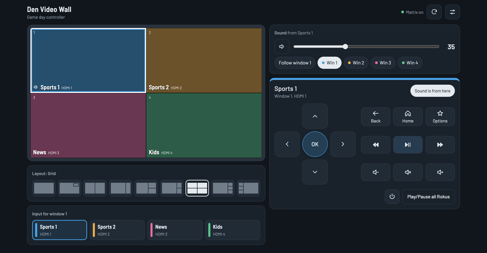
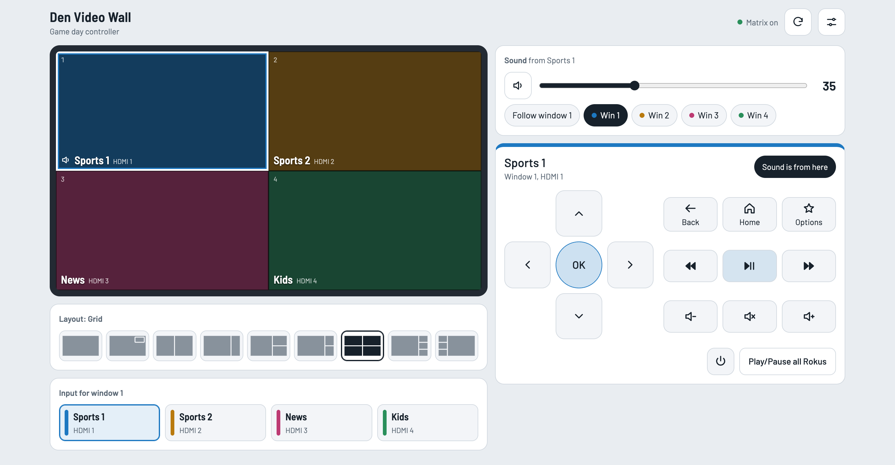
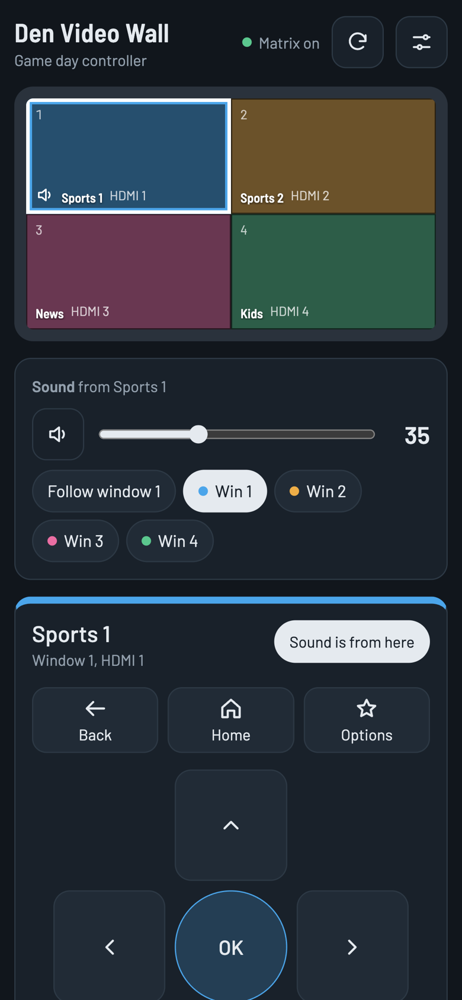

# Orei UHD-401MV Control Panel

A web remote for the Orei UHD-401MV HDMI multiviewer and the Rokus plugged into it. It runs on a Raspberry Pi connected to the Orei by RS-232 and works from any phone, tablet, or computer on the network.



| Light theme | Phone |
| --- | --- |
|  |  |

Screenshots use sample names and a simulated matrix.

## What it does

- Tap a window on the TV drawing, then pick its HDMI input.
- Switch between 9 layouts: full, inset, halves, three, and four-window grids.
- Choose which window the sound comes from and set the volume.
- Control each window's Roku with a full remote. Hold OK for an app's long-press menu.
- Name the controller and set up Rokus from Settings.
- Update, restart, or shut down the Pi from the browser.

## Quick start

1. Connect the Pi to the Orei's RS-232 port (GPIO UART or a USB serial adapter).
2. On a fresh Raspberry Pi OS install:
   ```bash
   git clone https://github.com/btdorr/orei-control.git
   cd orei-control
   ./setup.sh
   ```
3. Open `http://<pi-address>` and use Settings to find your Rokus.

## Docs

- [User guide](docs/user-guide.md): using the remote and Settings
- [Installation and configuration](docs/installation.md): setup, config files, branding, network
- [Troubleshooting](docs/troubleshooting.md)
- [API](docs/api.md)
- [Architecture](docs/architecture.md): how it works, security, updates
- [Development](DEVELOPMENT.md): branches, dev server, deploys
- [RS-232 commands](rs-232_commands.md): Orei protocol reference

## License

MIT. See [LICENSE](LICENSE).
