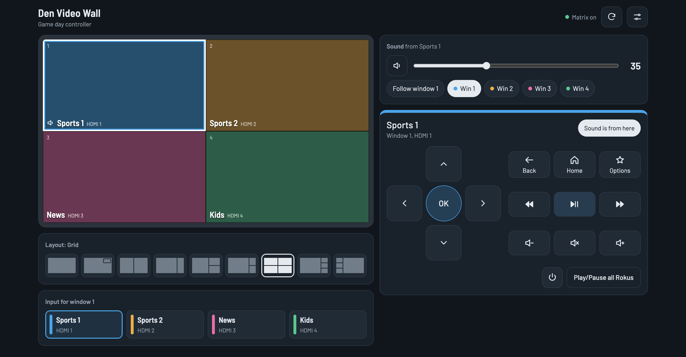
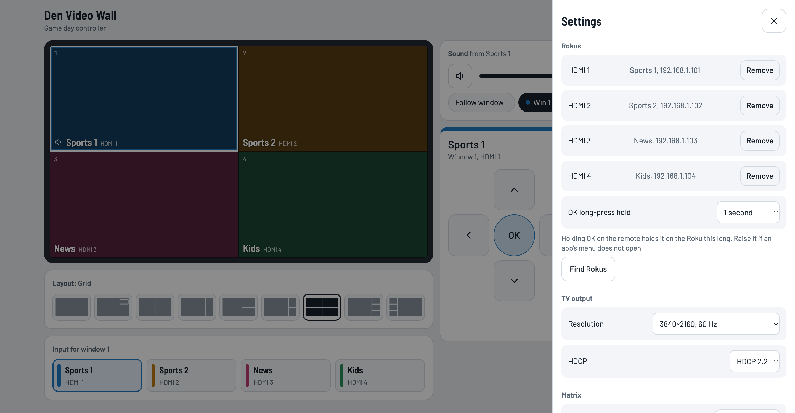
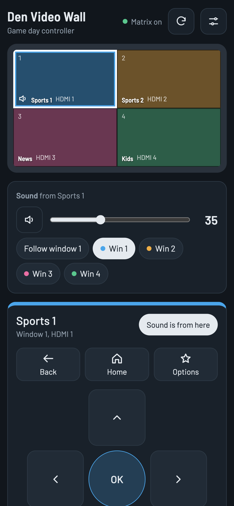
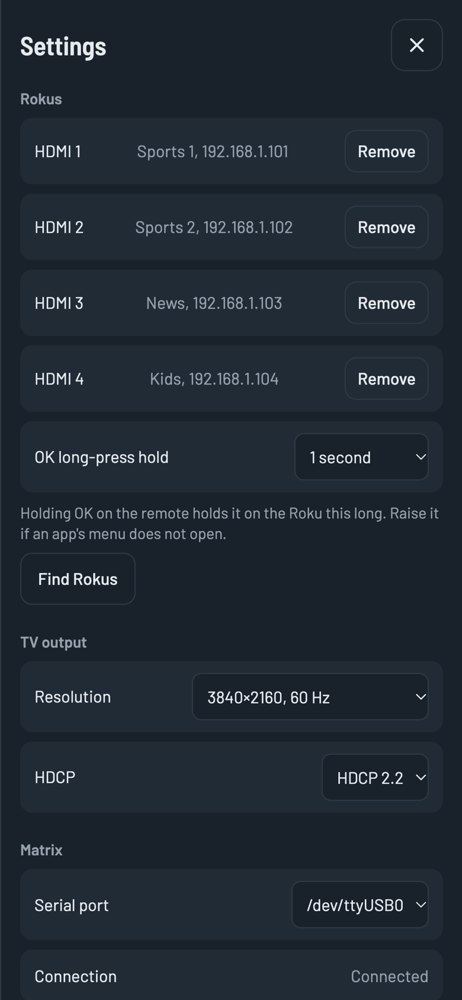

# User guide

Open `http://<pi-address>` in a browser. The page opens showing the last known state, then reads the matrix and corrects anything that changed.

## Main screen

### Status
The top right shows whether the controller can reach the matrix. The refresh button reads everything from the matrix again, which is useful after someone uses the Orei's own remote. If the matrix is off or unreachable, a banner explains what to check and offers **Turn on matrix** or **Try again**.

### TV drawing and inputs
The drawing matches what is on the TV. Each HDMI input has its own color everywhere it appears. The speaker icon marks the window the sound comes from.

1. Tap a window to select it.
2. Under **Input for window N**, tap the HDMI input to show there.

Inputs are labeled with the Roku names from Settings.

### Layout
Pick one of 9 layouts: Full, Inset, Halves, Big + side, Three, Big + two, Grid, Big + three, and Three + big. Inset adds corner and size buttons for the small window. The matrix remembers each layout's inputs separately.

### Sound
- **Follow window 1**: sound comes from whatever is in window 1.
- **Win 1** to **Win 4**: sound comes from that window's input.
- The slider sets the matrix volume. The speaker button mutes.

### Roku remote
The remote controls the Roku in the selected window. It has Back, Home, Options, the arrow pad, OK, playback, Roku volume, and power. **Play/Pause all Rokus** sends Play to every Roku at once.

**Hold OK** for about half a second to send a long press, like holding OK on the physical remote. Apps such as DirecTV use it to open an extra menu. The time the Roku sees the key held is set in Settings.

**Sound is from here** switches the sound to this window.

## Settings

Open Settings with the sliders button at the top right.

### Rokus
- **Find Rokus** searches the network (up to 30 seconds). Choose which HDMI input each Roku is connected to, then **Save Rokus**.
- **Remove** unlinks a Roku from its input.
- **OK long-press hold** sets how long a held OK is held on the Roku (0.5 to 5 seconds, default 1). Raise it if an app's menu does not open.

### TV output
Output resolution and HDCP mode of the matrix.

### Matrix
The serial port the controller uses, the connection state, and matrix power. Turning off asks for a second tap.

### Troubleshooting
The command log shows recent RS-232 commands and replies. You can also type a raw command, such as `r power!`. See [rs-232_commands.md](../rs-232_commands.md).

### Name
The title and subtitle at the top of the page and in the browser tab. Leave a field empty to use the default. Changes apply right away for this browser, and on the next page load everywhere else.

### Controller
- The version number.
- Theme: Auto (follows the device), Light, or Dark. Saved per browser.
- **Update** installs the latest version. The page reloads when it finishes, usually in 1 to 2 minutes.
- **Restart** and **Shut down** run after 1 minute and can be cancelled. Turning the Pi back on after a shutdown needs someone at the device.
- **Use the classic view** opens the original interface at `/classic`.

## Phone

The same page works on a phone. The layout stacks: TV drawing, sound, then the remote.

| Main screen | Settings |
| --- | --- |
|  |  |
